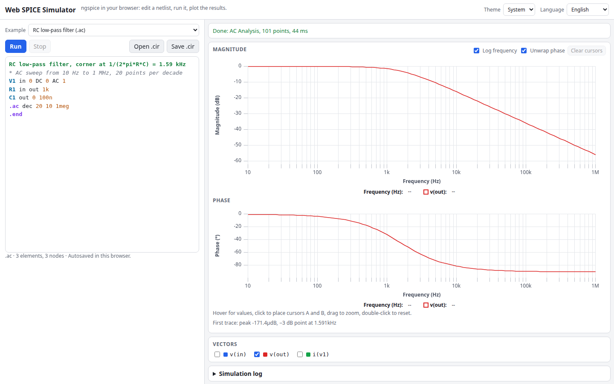

# Web SPICE Simulator

A SPICE circuit simulator that runs entirely in your browser. Edit a netlist, run `.op`, `.dc`, `.ac` or `.tran` with [ngspice](https://ngspice.sourceforge.io/) compiled to WebAssembly, and plot the results with dB/phase, several traces and measurement cursors. Nothing is uploaded; there is no backend.

**Try it: [hermes98761234.github.io/web-spice-simulator](https://hermes98761234.github.io/web-spice-simulator/)**

[](https://github.com/hermes98761234/web-spice-simulator/actions/workflows/deploy.yml)



## Features

- **Real ngspice (v45)** via the [`eecircuit-engine`](https://www.npmjs.com/package/eecircuit-engine) package, single-threaded in a Web Worker so the page stays responsive. A Stop button kills and restarts the worker.
- **Netlist editor** with SPICE syntax highlighting (elements, dot commands, numbers, parameters, comments), `Ctrl+Enter` to run, and a warning list (no ground, no analysis, several analyses).
- **Examples:** RC low-pass (`.ac`), series RLC ringing (`.tran`), diode rectifier, BJT common-emitter amplifier (`.ac`), MOSFET inverter transfer curve (`.dc`), voltage divider (`.op`) and a transistor astable multivibrator.
- **Plots with uPlot:** pick any vectors, multiple traces, AC shown as magnitude in dB plus unwrapped phase on a log frequency axis, hover readout, drag to zoom, and two pinned cursors A/B with a delta table. The -3 dB frequency is reported for AC runs.
- **`.op` table**, a simulation log with ngspice messages, and clear errors when a netlist cannot be parsed.
- **Open and save `.cir` files.** The netlist and settings are autosaved in `localStorage`.
- **English or Ukrainian, light, dark or system theme**, responsive layout.

## How it works

`src/sim.worker.ts` wraps `eecircuit-engine` (ngspice built with Emscripten, WASM embedded in the JS bundle). It needs no `SharedArrayBuffer`, so no COOP/COEP headers: it works on GitHub Pages under a sub-path. The raw output is turned into typed arrays (`src/lib/results.ts`), and dB, phase unwrapping and cursor lookups are pure functions. Netlist analysis (`src/lib/netlist.ts`) parses logical lines, analysis cards, elements and nodes. The engine silently returns stale data after a failed parse, so `src/lib/log.ts` inspects ngspice's messages to detect failed runs.

The worker bundle is about 20 MB (about 5.7 MB gzipped on the wire) and is loaded once, in the background.

Limitations: only the last analysis card of a netlist is plotted; `.control` scripts, `.measure` output and `.noise` plots are not specially handled; only ngspice's built-in device models and what you write in the netlist are available.

## Quick start

You need [Node.js](https://nodejs.org/) 22.

```bash
git clone https://github.com/hermes98761234/web-spice-simulator.git
cd web-spice-simulator
npm install
npm run dev       # http://localhost:5173
npm test          # unit tests, plus tests that run the real WASM engine in node
npm run build     # static site in dist/
```

## License

MIT
